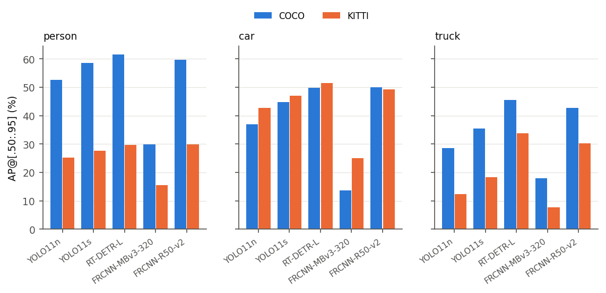
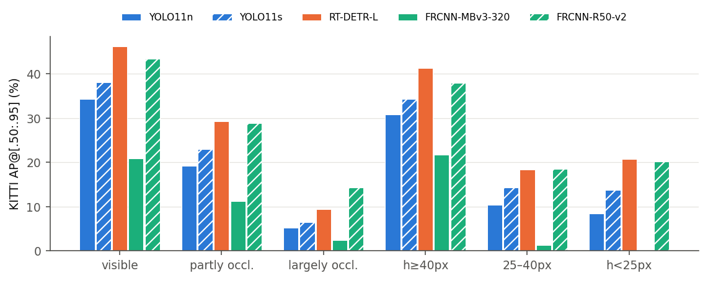
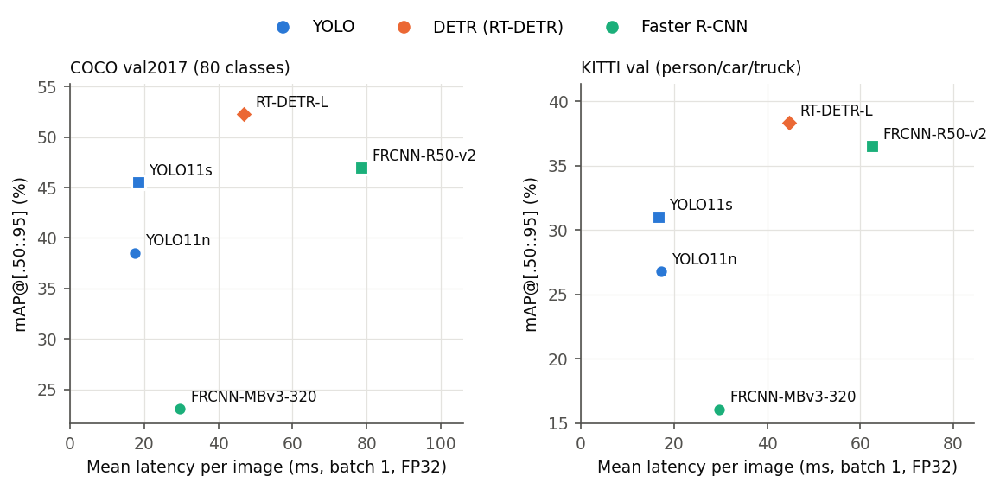
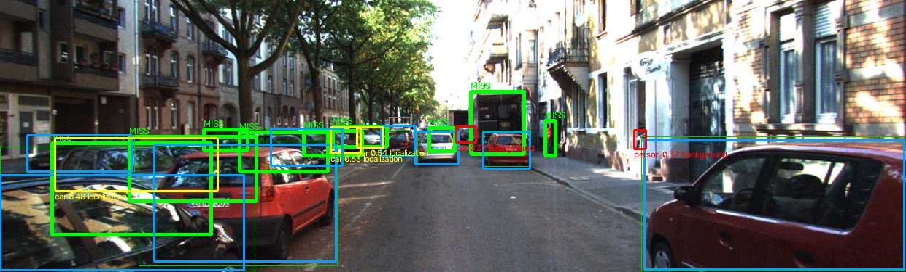

# Pretrained 2D Object Detectors from COCO to KITTI: Accuracy, Speed, and Domain Shift

<p class="subtitle">CMPE 249 Homework — Track A (Experimental). João Lucas Veras. Code, configurations, and command log: <a href="https://github.com/JoaoLucasVeras/2d-object-detection-evaluation">github.com/JoaoLucasVeras/2d-object-detection-evaluation</a> (branch <code>main</code>).</p>

## 1. Goal and summary

**Question.** How do modern pretrained detectors from three families compare in accuracy, latency, and memory, and how well do COCO-trained models transfer to autonomous-driving images without retraining?

I evaluated **five COCO-pretrained configurations from three detector families**: YOLO11n and YOLO11s (one-stage, anchor-free), RT-DETR-L (query-based transformer, NMS-free), and Faster R-CNN with a MobileNetV3-320 or ResNet-50-FPN-v2 backbone (two-stage, anchor-based). Each configuration ran on **COCO val2017 (5,000 images)** and a **KITTI validation subset (1,496 images)** on an RTX 3060 Ti, without fine-tuning. Ten main experiments and four ablations are documented in the saved run records. Predictions were scored with pycocotools. KITTI results use the study's mapped, COCO-style evaluation protocol, rather than official KITTI leaderboard scoring.

**Main findings.**

1. Measured COCO accuracy differs from the published reference values by about 0.25–1.49 AP (Table 2). A larger detection budget recovers 0.14 AP for YOLO11s; other validator differences remain unquantified.
2. Shared-class AP decreases by about 13–15 points for four configurations, and 4.45 for the weaker MobileNet baseline. **Cars generally retain accuracy; pedestrians and trucks lose AP.** Image distribution and annotation differences both affect this comparison.
3. Increasing YOLO input size to 1280 raises KITTI AP by 4.6–6.3 points for about 2 ms. YOLO11n at 1280 is more accurate, but slower, than YOLO11s at 640. Preserving RT-DETR's input aspect ratio improves small-object AP but decreases overall AP.
4. RT-DETR-L provides the highest AP on both datasets at roughly 21–22 FPS. YOLO offers faster operating points. These compare complete configurations, including their different backbones, resize rules, and implementations.

## 2. Models and datasets

**Table 1 — Model configurations** (all official COCO checkpoints; no fine-tuning)

| ID | Family / paradigm | Checkpoint | Framework | Input resize |
|---|---|---|---|---|
| YOLO11n | YOLO; one-stage, anchor-free, DFL box head, NMS | `yolo11n.pt` | Ultralytics 8.3.200 | letterbox, long side 640 |
| YOLO11s | same family, larger width/depth | `yolo11s.pt` | Ultralytics 8.3.200 | letterbox, long side 640 |
| RT-DETR-L | DETR; hybrid CNN+transformer encoder, 300 object queries, Hungarian-trained, **no NMS** | `rtdetr-l.pt` | Ultralytics 8.3.200 | **stretched** to 640×640 |
| FRCNN-MBv3-320 | Faster R-CNN; two-stage, anchor-based RPN + RoI head, NMS | `FasterRCNN_MobileNet_V3_Large_320_FPN_Weights.COCO_V1` | torchvision 0.23 | short side 320, long ≤ 640 |
| FRCNN-R50-v2 | Faster R-CNN; ResNet-50-FPN, improved v2 recipe | `FasterRCNN_ResNet50_FPN_V2_Weights.COCO_V1` | torchvision 0.23 | short side 800, long ≤ 1333 |

The five configurations cover three families. Faster R-CNN uses region proposals and per-region refinement [1], with multi-scale FPN features [2]. Its backbones follow MobileNetV3 [8] and torchvision's improved ResNet recipe [9,13]. DETR uses object-query set prediction [3], extended for efficiency by RT-DETR [4]. The original YOLO paper [5] supplies historical context; YOLO11 implementation details and benchmark values come from the official documentation and versioned code [12].

**COCO val2017** [6]: 5,000 images, 80 classes, official `instances_val2017.json`.

**KITTI** [7]: I used the 1,496-image validation split distributed with Ultralytics' KITTI dataset (images drawn from the official KITTI 2D-object *training* set, so labels exist). I did not use Ultralytics' YOLO-format labels. Instead I re-attached the **official KITTI `label_2` files**, which keep the `DontCare`, `Van`, occlusion, and truncation fields. The scored ground truth contains 5,716 cars, 921 pedestrians, and 223 trucks, plus 9,373 ignore regions.

**Taxonomy mapping** (`configs/kitti_taxonomy.json`). The models output COCO classes, so KITTI labels are mapped onto them:

| KITTI label | Treatment |
|---|---|
| Car → car, Truck → truck, Pedestrian → person | scored |
| Van | ignore region for car and truck (COCO has no van; KITTI's own protocol also ignores Van when scoring Car) |
| Person_sitting, Cyclist | ignore region for person (a COCO model correctly boxes a cyclist's rider as *person* and the bike as *bicycle*) |
| Tram, Misc, DontCare | ignore region for all three classes |

Ignore regions are encoded as COCO `iscrowd=1` annotations. Detections matched to them under COCOeval's crowd rules are excluded from scoring; mere overlap does not automatically exclude a detection [14]. Other predicted categories do not contribute to KITTI's three-class scores. COCO is also re-scored on **the same three classes** ("COCO-3"). This aligns the label set, but cannot remove differences in annotation, viewpoints, scale distributions, or sampling. KITTI area groups use box area, whereas COCO annotations can use segmentation area. The mapped KITTI results are **COCO-style AP, not official KITTI AP_R40**.

## 3. Experimental setup and hardware

| Item | Value |
|---|---|
| GPU | NVIDIA GeForce RTX 3060 Ti 8 GB; saved driver version 610.88 |
| Software | Windows 11, Python 3.11.9, PyTorch 2.8.0+cu126, torchvision 0.23.0, Ultralytics 8.3.200, pycocotools 2.0.10, cuDNN 9.10 |
| Precision / batch | FP32, batch size 1 |
| Score threshold | 0.001 (standard for mAP) |
| NMS IoU | 0.7 (Ultralytics YOLO default), 0.5 (torchvision default), none (RT-DETR) |
| Detections kept | Global top 100 per image by score; separate from COCOeval's per-category maxDets limit |
| Evaluator | pycocotools `COCOeval` bbox, IoU 0.50:0.05:0.95, maxDets 100 |
| Latency | 20 warm-up passes; CUDA synchronization around decoded host-memory image → CPU boxes. Includes preprocessing, transfer, network, and framework post-processing/NMS. Excludes decoding, disk I/O, final wrapper sorting and JSON serialization. |
| Memory | `torch.cuda.max_memory_allocated` over the run (PyTorch allocator, not whole-process) |

## 4. Commands and configuration

Configurations live in `configs/models.json` and `configs/kitti_taxonomy.json`. Each inference run writes a JSON record (`results/runs/*.json`) with its command, settings, timing boundary, and environment. The main and ablation runners append experiment commands to `results/command_log.txt`. Saved metrics and logs document the desktop runs; the final report edit did not rerun GPU inference.

```
powershell -ExecutionPolicy Bypass -File scripts/setup_windows.ps1   # venv, CUDA check, smoke test
.venv/Scripts/python.exe scripts/prepare_data.py                     # COCO val2017 + KITTI GT conversion
.venv/Scripts/python.exe scripts/run_inference.py --model rtdetr_l --dataset kitti
.venv/Scripts/python.exe scripts/evaluate.py      --model rtdetr_l --dataset kitti
powershell -File scripts/run_all.ps1          # all 5 models x 2 datasets
powershell -File scripts/run_ablations.ps1    # Section 5.4
.venv/Scripts/python.exe scripts/failure_analysis.py --dataset kitti --draw yolo11s
.venv/Scripts/python.exe scripts/summarize.py # tables (results/summary.md) and figures
```

## 5. Quantitative results

**Table 2 — COCO val2017, 80 classes** (AP in %, latency in ms)

| Model | Input | AP | AP50 | AP75 | AP_S | AP_M | AP_L | AR100 | Latency mean / p90 | FPS | Peak MiB | Published AP |
|---|---|---|---|---|---|---|---|---|---|---|---|---|
| YOLO11n | 640 | 38.5 | 53.8 | 41.9 | 18.9 | 42.3 | 56.1 | 54.0 | 17.5 / 18.2 | 57.3 | 69 | 39.5 |
| YOLO11s | 640 | 45.5 | 62.0 | 49.2 | 27.6 | 50.1 | 62.5 | 60.2 | 18.4 / 19.4 | 54.4 | 110 | 47.0 |
| RT-DETR-L | 640 | **52.2** | 70.4 | **56.6** | **33.4** | **56.9** | **70.5** | **67.6** | 47.0 / 51.9 | 21.3 | 238 | 53.0 |
| FRCNN-MBv3-320 | 320 | 23.1 | 38.9 | 23.4 | 2.8 | 22.3 | 44.9 | 32.1 | 29.7 / 31.5 | 33.7 | 129 | 22.8 |
| FRCNN-R50-v2 | 800 | 47.0 | 67.9 | 51.4 | 31.0 | 50.8 | 60.4 | 63.0 | 78.5 / 82.4 | 12.7 | 672 | 46.7 |

**Table 3 — KITTI val, classes person/car/truck**

| Model | AP | AP50 | AP75 | AP_S | AP_M | AP_L | AR100 | Latency mean | FPS | Peak MiB |
|---|---|---|---|---|---|---|---|---|---|---|
| YOLO11n | 26.8 | 52.4 | 24.4 | 12.4 | 24.6 | 41.5 | 41.3 | 17.2 | 58.1 | 52 |
| YOLO11s | 31.0 | 57.9 | 30.6 | 18.2 | 29.0 | 45.0 | 44.4 | 16.6 | 60.3 | 83 |
| RT-DETR-L | **38.3** | 66.9 | **38.8** | **30.3** | **34.8** | **52.8** | 52.9 | 44.7 | 22.4 | 238 |
| FRCNN-MBv3-320 | 16.1 | 34.5 | 14.1 | 0.2 | 9.3 | 38.6 | 26.8 | 29.6 | 33.8 | 121 |
| FRCNN-R50-v2 | 36.5 | **67.2** | 37.4 | 25.5 | 33.7 | 48.6 | **55.8** | 62.6 | 16.0 | 442 |

Per-class AP and complete metrics are in `results/metrics/*.json`; `scripts/summarize.py` creates `results/summary.md`. AP averages precision across confidence rankings and IoU thresholds; it is not the fraction of objects detected. FPS is 1000 divided by mean per-image milliseconds, not concurrent video throughput. Published AP values are sanity-check references [12,13], not exact protocol reproductions. The two tables average different category sets, so their AP difference alone does not measure transfer.

### 5.1 Analysis 1 — Cross-dataset generalization

**Table 4 — COCO-3 → KITTI** (AP@[.50:.95] per class)

| Model | COCO-3 AP | KITTI AP | Δ | person | car | truck |
|---|---|---|---|---|---|---|
| YOLO11n | 39.4 | 26.8 | −12.6 | 52.7 → 25.2 | 37.1 → 42.8 | 28.5 → 12.4 |
| YOLO11s | 46.3 | 31.0 | −15.3 | 58.6 → 27.7 | 44.8 → 47.1 | 35.4 → 18.3 |
| RT-DETR-L | 52.3 | 38.3 | −14.0 | 61.5 → 29.7 | 49.8 → 51.6 | 45.6 → 33.7 |
| FRCNN-MBv3-320 | 20.6 | 16.1 | −4.4 | 29.9 → 15.5 | 13.7 → 25.0 | 18.0 → 7.8 |
| FRCNN-R50-v2 | 50.8 | 36.5 | −14.3 | 59.7 → 30.0 | 50.0 → 49.3 | 42.7 → 30.2 |


<p class="caption">Figure 1. Per-class AP on COCO (restricted to the shared classes) and on KITTI. Cars transfer; persons and trucks do not.</p>

**Which classes degrade most?** The roughly 13–15 point drop for four configurations hides different class behaviors:

* **Car transfers relatively well.** Four configurations improve in car AP; R50-v2 decreases by 0.63 points. This demonstrates category-dependent transfer, without establishing which dataset is universally easier.
* **Person loses substantial AP.** For YOLO11n/s, RT-DETR-L, and R50-v2, person AP decreases by approximately 27–32 points. AP50 also falls (YOLO11s 81.4 → 62.7; RT-DETR 85.8 → 66.1). The saved failure counts show increasing misses with occlusion, supporting occlusion as a relevant difficulty. They do not isolate its causal contribution from appearance and annotation differences.
* **Truck AP decreases by about 10–17 points.** Vehicle appearance and category conventions are plausible contributors. The checked-in failure analyzer only classifies confusion among person/car/truck; it does not quantify truck-to-bus/train confusion. Consequently, no numerical claim about those unmeasured confusions is made here.

**Which scales degrade most?** For YOLO11s, shared-class AP_S falls from 27.7 to 18.2 and AP_M from 55.6 to 29.0. For RT-DETR, AP_S changes from 33.8 to 30.3 and AP_M from 61.0 to 34.8. Medium objects lose more in absolute points. These are descriptive comparisons: category composition and area definitions differ, so scale has not been isolated as the cause.

The KITTI breakdowns (Figure 2) show declining AP across occlusion levels 0, 1, and 2. A **moderate-like filter** (height ≥25 px, occlusion ≤1, truncation ≤0.3) gives RT-DETR-L 42.8, R50-v2 40.9, YOLO11s 35.6, YOLO11n 31.7, and MobileNet 18.6 AP. These retain COCO-style scoring and are not official KITTI moderate benchmark scores [7,14].


<p class="caption">Figure 2. KITTI AP for subsets by occlusion level (KITTI labels 0/1/2) and by box height. Objects outside each subset become ignore regions.</p>

### 5.2 Analysis 2 — Speed–accuracy trade-off


<p class="caption">Figure 3. Accuracy vs mean per-image latency on the RTX 3060 Ti (FP32, batch 1, end-to-end excluding decode). Color = family; marker = model size.</p>

* **YOLO11s trades a small measured cost for higher accuracy.** On COCO, it adds 6.98 AP over YOLO11n for 0.94 ms. On KITTI it is both more accurate and slightly faster in these runs. Without repeated independent runs, the small timing advantage should not be treated as a stable property. Profiling would be needed to establish whether CPU or kernel-launch overhead dominates.
* **The tested Faster R-CNN configurations cost more time.** MobileNet takes 29.7 ms on COCO, more than either YOLO, while R50-v2 takes 78.5 ms and 672 MiB for 46.95 AP. R50-v2 is about 1.7 times slower than RT-DETR-L, with roughly 2.8 times its allocated memory and 5.29 less AP. Backbone, recipe, input size, and implementation vary together; this does not isolate the two-stage design's causal cost.
* **RT-DETR-L is on the Pareto front** (52.2 AP, 47 ms). It costs about 2.6× YOLO11s's latency for +6.7 AP on COCO and +7.3 AP on KITTI.
* **Image geometry also varies.** R50-v2 is faster on KITTI (62.6 ms) than COCO (78.5 ms). Its long-side cap gives approximately 1333×402 for a representative 1242×375 KITTI frame. YOLO instead has about 640×193 content plus stride padding, while RT-DETR processes 640×640. These differences help motivate the geometry ablation; they do not independently explain the full timing gap.

### 5.3 Analysis 3 — Architecture comparison: YOLO vs RT-DETR vs Faster R-CNN

* **Post-processing and duplicates.** YOLO11 and Faster R-CNN use NMS. RT-DETR uses query-based set prediction and NMS-free inference [3,4,12]. At the selected KITTI thresholds it produces 30 duplicates versus 86 for YOLO11s and 109 for YOLO11n. R50-v2 produces 15. Threshold differences prevent interpreting these counts as a controlled architecture comparison.
* **Score operating points differ.** Selected F1-optimal thresholds are 0.35 for YOLO, 0.55 for RT-DETR, and 0.5–0.9 for Faster R-CNN. Different confidence scales warrant model-specific thresholds. Formal score-calibration error was not measured.
* **Localization quality.** KITTI AP75/AP50 is approximately 0.58 for RT-DETR, 0.56 for R50-v2, 0.53 for YOLO11s, and 0.41 for MobileNet. Localization error is the largest recorded false-positive category for every baseline; crowded parked cars illustrate one setting where it occurs (Figure 4).
* **Hard-object performance.** R50-v2 leads in KITTI AR100 (55.8) and largely occluded subset AP (14.3 versus 9.5 for RT-DETR). Higher input resolution and proposal processing are possible contributors, but were not isolated experimentally.

### 5.4 Ablations: input geometry and detection budget

**Table 5 — Ablations** (KITTI rows; one COCO row for the detection budget)

| Configuration | Dataset | AP | AP50 | AP_S | AP_M | AP_L | Latency ms | Peak MiB |
|---|---|---|---|---|---|---|---|---|
| RT-DETR-L, stretched to 640×640 (default) | KITTI | **38.3** | 66.9 | 30.3 | 34.8 | **52.8** | 44.7 | 238 |
| RT-DETR-L, pad to square → 640×193 content | KITTI | 37.2 | 66.8 | **33.5** | 34.8 | 48.9 | 49.0 | 238 |
| YOLO11s, 640 (default) | KITTI | 31.0 | 57.9 | 18.2 | 29.0 | 45.0 | 16.6 | 83 |
| YOLO11s, 1280 | KITTI | **35.6** | 64.0 | **32.8** | 33.0 | 45.6 | 18.5 | 123 |
| YOLO11n, 640 (default) | KITTI | 26.8 | 52.4 | 12.4 | 24.6 | 41.5 | 17.2 | 52 |
| YOLO11n, 1280 | KITTI | **33.1** | 61.2 | **21.9** | 32.0 | 43.8 | 19.5 | 78 |
| YOLO11s, top-100 detections (default) | COCO | 45.5 | 62.0 | 27.6 | 50.1 | 62.5 | 18.4 | 110 |
| YOLO11s, top-300 detections | COCO | 45.7 | 62.3 | 27.8 | 50.2 | 62.5 | 17.9 | 110 |

**Input resolution on wide frames (YOLO).** A representative KITTI frame contains about 1280×387 image pixels rather than 640×193 before padding. YOLO11s gains 4.56 AP overall and 14.54 small-object AP; YOLO11n gains 6.28 AP overall. Latency increases by 1.95 and 2.33 ms respectively. YOLO11n at 1280 is more accurate, but slower, than YOLO11s at 640. These results support testing input resolution alongside model size, rather than assuming one is always the better choice.

**Stretching vs aspect preservation (RT-DETR).** `RTDETRPredictor.pre_transform` resizes to 640×640 with `scale_fill=True` [12]. Padding the original image to a square first preserves proportions after resizing. This increases small-object AP from 30.26 to 33.54, lowers large-object AP from 52.83 to 48.87, and lowers overall AP by 1.10. Thus stretching alone does not explain RT-DETR's small-object advantage. The experiment also changes padding and content geometry, so the remaining gap cannot be attributed solely to architecture.

**Detection budget (COCO).** Keeping the top 300 detections per image instead of 100 changes YOLO11s from 45.51 to 45.65 AP. That covers only 0.1 of the 1.5-point gap to the published 47.0. A remaining protocol difference I verified in the source: Ultralytics' validator runs NMS with `multi_label=True` (`ultralytics/models/yolo/detect/val.py`), so one box can contribute a detection for several classes. The `predict()` path I used keeps one label per box. I did not run the validator, so the size of this effect is not measured.

## 6. Failure analysis

For each model, `scripts/failure_analysis.py` searches thresholds 0.05–0.95 in 0.05 steps for the highest F1 at IoU 0.5 on this same validation set. Greedy matching labels unmatched detections as duplicate, evaluated-class confusion, localization error, or background; ignored-region matches are excluded. Misses are split by height and occlusion. These are descriptive validation operating points, not independently validated deployment thresholds. Counts depend on both the detector and the chosen threshold.

| Model (KITTI) | Thr | F1 | Background FP | Localization FP | Duplicate | Class conf. | Miss rate h<25 / 25–40 / 40–100 / ≥100 px |
|---|---|---|---|---|---|---|---|
| YOLO11n | 0.35 | 0.72 | 207 | 457 | 109 | 35 | 0.64 / 0.49 / 0.35 / 0.14 |
| YOLO11s | 0.35 | 0.78 | 226 | 459 | 86 | 46 | 0.45 / 0.35 / 0.28 / 0.14 |
| RT-DETR-L | 0.55 | **0.82** | 161 | 419 | 30 | 38 | 0.29 / 0.27 / 0.26 / 0.14 |
| FRCNN-MBv3-320 | 0.50 | 0.54 | 219 | 698 | 75 | 48 | 0.96 / 0.84 / 0.50 / 0.21 |
| FRCNN-R50-v2 | 0.90 | 0.81 | 310 | 593 | 15 | 5 | 0.24 / 0.26 / 0.25 / 0.15 |


<p class="caption">Figure 4. Selected difficult KITTI image 000146, YOLO11s threshold 0.35. Blue/orange = true positive; bright green MISS = unmatched ground truth; yellow = localization error; red = background FP; gray = ignored region. Crowded cars and distant objects illustrate failure cases. This is a selected high-error image, not a random sample or an estimate of error frequency.</p>

**Failure modes, with evidence.**

1. **Small, distant objects.** Miss rates below 25 px height are 45–64% for YOLO, 96% for MobileNet, and 24–29% for R50-v2 and RT-DETR. Higher-resolution YOLO improves small-object AP, but no corresponding high-resolution miss-rate analysis was saved.
2. **Occlusion.** Miss rate grows from 10–20% (fully visible) to 54–72% (largely occluded) for every model except FRCNN-MBv3-320, which is worse throughout.
3. **Crowded parked cars.** The figure illustrates localization errors, which are the largest recorded FP category for every baseline; their causes were not quantified by scene type.
4. **Truck errors.** Truck AP falls across configurations. Appearance and taxonomy mismatch are plausible contributors, but bus/train confusion was not quantified by the saved analyzer.
5. **Background false positives.** These are 21–34% of false positives at the operating point (for example, the object by the doorway predicted as a person in Figure 4). I did not categorize them further, so their specific causes are not quantified here.
6. **Input resolution.** FRCNN-MBv3-320 misses 96% of objects under 25 px tall at the selected threshold, and small-object AP is near zero (2.8 COCO, 0.2 KITTI). This association does not isolate resolution from backbone and checkpoint effects.

## 7. Conclusions

* COCO AP is within approximately 1.5 points of the published values. This is a useful sanity check, but protocol differences remain. The detection-budget experiment does not resolve the remaining YOLO gap; the native validator is a future check.
* Shared-class transfer is uneven: pedestrian and truck AP decline while cars generally retain performance. The weaker MobileNet model's smaller aggregate drop does not establish greater robustness from its low starting AP. Annotation and visual-distribution changes are intertwined.
* Increasing YOLO resolution adds 4.56–6.28 AP on KITTI with about 2 ms additional measured latency. RT-DETR's aspect-preservation experiment shows that stretching alone does not explain its small-object lead. Full preprocessing settings must accompany model names.
* RT-DETR-L is most accurate here. Among tested KITTI configurations above 50 FPS, YOLO11s at 1280 has the highest AP (35.58). R50-v2 leads in KITTI recall and largely occluded subset AP, but costs more time and memory. These are configuration-specific findings, not hardware-independent rankings.
* **Limitations.** Only one GPU, FP32, batch 1, and one full timing run per configuration were evaluated. There are no repeated-run confidence intervals or independent threshold-tuning data. The KITTI mapping is custom and has only 223 scored trucks. Predictions and datasets remain local to the desktop; the checked-in metrics cannot be independently recomputed without those artifacts or rerunning inference. Fine-tuning, repeated timing, native validation, and FP16/TensorRT tests are useful extensions.

**AI assistance and reproducibility.** Codex assisted with setup, code review, interpretation, reference checks, and report editing. Measurements come from the saved desktop artifacts; no new results were generated during editing. Preserve the dataset files, checkpoint versions, environment freeze, and repository revision when reproducing the work. The repository is private: grant the instructor access or include a ZIP of scripts, configurations, and logs with the PDF.

## 8. References

1. S. Ren, K. He, R. Girshick, and J. Sun. *Faster R-CNN: Towards Real-Time Object Detection with Region Proposal Networks.* NeurIPS, 2015. [Original paper](https://arxiv.org/abs/1506.01497).
2. T.-Y. Lin, P. Dollár, R. Girshick, K. He, B. Hariharan, and S. Belongie. *Feature Pyramid Networks for Object Detection.* CVPR, 2017. [Original paper](https://arxiv.org/abs/1612.03144).
3. N. Carion, F. Massa, G. Synnaeve, N. Usunier, A. Kirillov, and S. Zagoruyko. *End-to-End Object Detection with Transformers.* ECCV, 2020. [Original paper](https://arxiv.org/abs/2005.12872).
4. Y. Zhao, W. Lv, S. Xu, J. Wei, G. Wang, Q. Dang, Y. Liu, and J. Chen. *DETRs Beat YOLOs on Real-time Object Detection.* CVPR, 2024. [Original paper](https://arxiv.org/abs/2304.08069).
5. J. Redmon, S. Divvala, R. Girshick, and A. Farhadi. *You Only Look Once: Unified, Real-Time Object Detection.* CVPR, 2016. Historical YOLO-family context, not the YOLO11 implementation reference. [Original paper](https://arxiv.org/abs/1506.02640).
6. T.-Y. Lin et al. *Microsoft COCO: Common Objects in Context.* ECCV, 2014. [Original paper](https://arxiv.org/abs/1405.0312).
7. A. Geiger, P. Lenz, and R. Urtasun. *Are we ready for Autonomous Driving? The KITTI Vision Benchmark Suite.* CVPR, 2012. [Original paper](https://www.cvlibs.net/publications/Geiger2012CVPR.pdf); [official evaluation protocol](https://www.cvlibs.net/datasets/kitti/eval_object.php?obj_benchmark=2d).
8. A. Howard et al. *Searching for MobileNetV3.* ICCV, 2019. [Original paper](https://arxiv.org/abs/1905.02244).
9. Y. Li, S. Xie, X. Chen, P. Dollár, K. He, and R. Girshick. *Benchmarking Detection Transfer Learning with Vision Transformers.* arXiv:2111.11429, 2021. Training-recipe context linked by torchvision's R50-v2 documentation. [Original paper](https://arxiv.org/abs/2111.11429).
10. C. Feng, Y. Zhong, Y. Gao, M. R. Scott, and W. Huang. *TOOD: Task-aligned One-stage Object Detection.* ICCV, 2021. Background for task-aligned assignment. [Original paper](https://arxiv.org/abs/2108.07755).
11. X. Li, W. Wang, L. Wu, S. Chen, X. Hu, J. Li, J. Tang, and J. Yang. *Generalized Focal Loss: Learning Qualified and Distributed Bounding Boxes for Dense Object Detection.* NeurIPS, 2020. Background for distributional box regression. [Original paper](https://arxiv.org/abs/2006.04388).
12. Ultralytics. Official [YOLO11 documentation and benchmark table](https://docs.ultralytics.com/models/yolo11/) and [RT-DETR documentation and benchmark table](https://docs.ultralytics.com/models/rtdetr/). [Source version 8.3.200](https://github.com/ultralytics/ultralytics/tree/v8.3.200): `ultralytics/models/rtdetr/predict.py`, `RTDETRPredictor.pre_transform`; `ultralytics/models/yolo/detect/val.py`, `DetectionValidator.postprocess`. Accessed October 31, 2026.
13. PyTorch / torchvision. Official version 0.23 model and weight documentation: [Faster R-CNN MobileNetV3-320-FPN](https://docs.pytorch.org/vision/0.23/models/generated/torchvision.models.detection.fasterrcnn_mobilenet_v3_large_320_fpn.html) and [Faster R-CNN ResNet50-FPN-v2](https://docs.pytorch.org/vision/0.23/models/generated/torchvision.models.detection.fasterrcnn_resnet50_fpn_v2.html). Accessed October 31, 2026.
14. T.-Y. Lin, P. Dollár, and COCO API contributors. Official [COCOeval source](https://github.com/cocodataset/cocoapi/blob/master/PythonAPI/pycocotools/cocoeval.py), `PythonAPI/pycocotools/cocoeval.py`. Experiment dependency: pycocotools 2.0.10. Accessed October 31, 2026.
15. K. Liu. *DeepDataMiningLearning: ngdet tutorial.* Course starting point. [Repository](https://github.com/lkk688/DeepDataMiningLearning). Accessed October 31, 2026.
